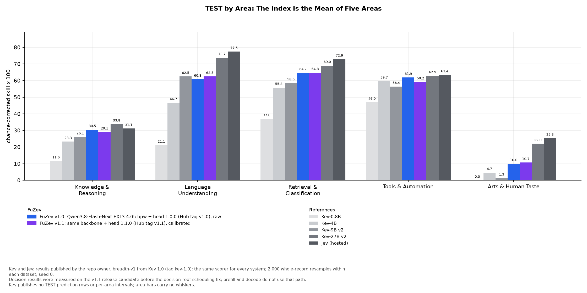
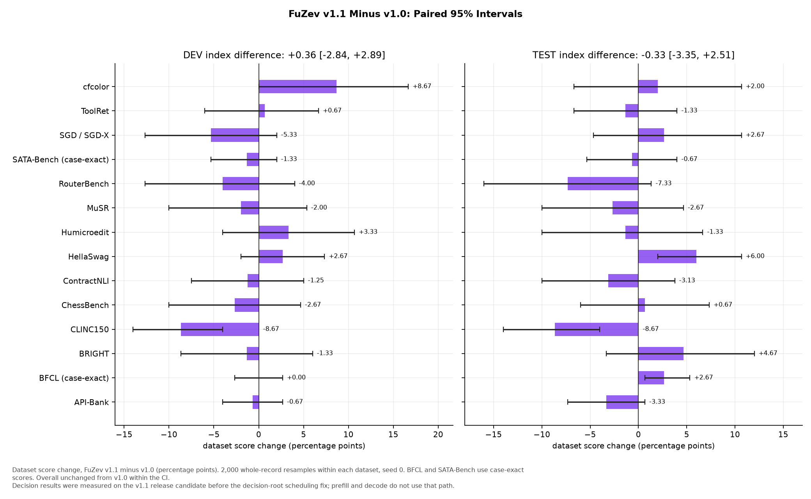
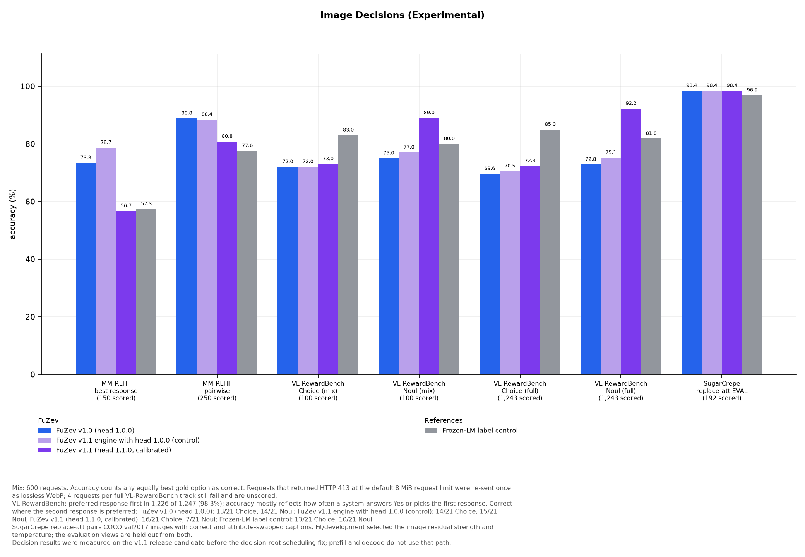
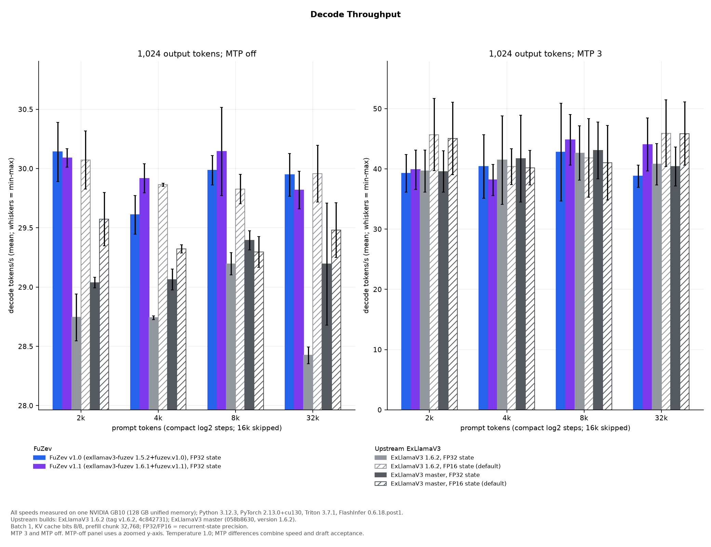

# v1.0 And v1.1 Served Comparison

Recorded comparison of the published v1.0 head, the v1.1 head (bundle 1.1.0),
and upstream ExLlamaV3. Tables below derive from the linked
[aggregate JSON](results/README.md#v10-and-v11-comparison); full precision stays
in those records. The [v1.0 cross-engine quality study](benchmarks-v1.0.md)
uses earlier research servers and an offline TEST read.

Decision results in this comparison were measured on the v1.1 release
candidate before the
[decision-root scheduling fix](integration-v1.1.md#decision-root-checks);
prefill and decode do not use that path.

## Text

Overall unchanged from v1.0 within the CI; CLINC150 drops 8.7 points on both
splits. The paired v1.1-minus-v1.0 index intervals are
DEV [-2.84, 2.89] and
TEST [-3.35, 2.51] points.
Against Kev-9B v2 on DEV, the paired difference is
[3.75, 10.30] index points
(95% paired bootstrap, 2,000 resamples, seed 0).
Kev publishes no TEST rows, so TEST has no paired test.


FuZev bars are served re-runs: each release's own ExLlamaV3 HTTP server,
the same 4.05 bpw backbone, and one SystemOne request per Kev record.
Kev and Jev: results published by the repo owner.
FuZev trains a 2.9M-parameter head on a frozen backbone; Kev-0.8B/4B/9B
fine-tune LoRA adapters and pointer heads on dense Qwen3.5 bases, Kev-27B v2
fine-tunes its backbone, and Jev is hosted. [Record and sources](results/comparison/v1.1/kev-published.json).



### DEV

Kev 1.0 `breadth-v1`, 1990 records /
3075 questions.
Dataset scores and question accuracy are percentages. BFCL and SATA-Bench use
case-exact scores in the main rows and question accuracy in the extra rows.
Kev and Jev: results published by the repo owner.

| Metric | FuZev v1.0 | FuZev v1.1 | Kev-0.8B | Kev-4B | Kev-9B v2 | Kev-27B v2 | Jev |
| --- | --- | --- | --- | --- | --- | --- | --- |
| API-Bank | 92.00 | 91.33 | 74.00 | 88.00 | 89.33 | 91.33 | 94.67 |
| BFCL (case-exact) | 92.00 | 92.00 | 74.67 | 94.00 | 94.67 | 96.00 | 98.00 |
| BRIGHT | 69.33 | 68.00 | 36.00 | 56.00 | 54.67 | 66.67 | 69.33 |
| cfcolor | 49.33 | 58.00 | 50.67 | 50.00 | 48.00 | 54.00 | 54.67 |
| ChessBench | 30.67 | 28.00 | 24.00 | 18.00 | 23.33 | 27.33 | 31.33 |
| CLINC150 | 97.33 | 88.67 | 77.33 | 88.00 | 83.33 | 94.67 | 97.33 |
| ContractNLI | 71.25 | 70.00 | 41.25 | 63.75 | 74.38 | 80.63 | 79.38 |
| HellaSwag | 88.67 | 91.33 | 50.67 | 78.00 | 81.33 | 88.67 | 89.33 |
| Humicroedit | 56.00 | 59.33 | 44.67 | 57.33 | 56.00 | 59.33 | 58.00 |
| MuSR | 73.33 | 71.33 | 46.67 | 53.33 | 56.67 | 62.67 | 69.33 |
| RouterBench | 34.67 | 30.67 | 26.67 | 34.00 | 18.00 | 33.33 | 28.67 |
| SATA-Bench (case-exact) | 48.67 | 47.33 | 27.33 | 35.33 | 38.00 | 48.67 | 43.33 |
| SGD / SGD-X | 71.33 | 66.00 | 56.67 | 59.33 | 66.00 | 72.67 | 79.33 |
| ToolRet | 61.33 | 62.00 | 49.33 | 62.00 | 66.00 | 68.00 | 63.33 |
| BFCL question accuracy | 94.12 | 94.77 | 80.07 | 96.41 | 96.73 | 98.04 | 99.02 |
| SATA-Bench question accuracy | 85.09 | 84.78 | 75.08 | 80.92 | 80.50 | 85.71 | 83.00 |
| Overall question accuracy | 74.93 | 74.37 | 59.71 | 69.56 | 69.95 | 75.74 | 75.74 |
| breadth-v1 index [95% CI] | 50.26 [47.83, 53.30] | 50.62 [47.53, 53.66] | 25.35 [23.11, 28.21] | 40.78 [38.25, 44.00] | 43.31 [40.86, 46.27] | 52.03 [49.42, 54.93] | 53.35 [50.67, 56.32] |

Sources: [FuZev v1.0](results/comparison/v1.1/kev-dev-v1.0.json),
[FuZev v1.1](results/comparison/v1.1/kev-dev-v1.1.json),
[Kev and Jev](results/comparison/v1.1/kev-published.json).

### TEST

Kev 1.0 `breadth-v1`, 1990 records /
3089 questions.
Kev and Jev: results published by the repo owner.

| Metric | FuZev v1.0 | FuZev v1.1 | Kev-0.8B | Kev-4B | Kev-9B v2 | Kev-27B v2 | Jev |
| --- | --- | --- | --- | --- | --- | --- | --- |
| API-Bank | 93.33 | 90.00 | 76.67 | 89.33 | 95.33 | 94.67 | 92.67 |
| BFCL (case-exact) | 86.67 | 89.33 | 70.67 | 90.00 | 91.33 | 93.33 | 91.33 |
| BRIGHT | 64.67 | 69.33 | 35.33 | 52.67 | 60.00 | 68.00 | 72.00 |
| cfcolor | 52.67 | 54.67 | 46.67 | 50.67 | 51.33 | 65.33 | 66.00 |
| ChessBench | 20.67 | 21.33 | 16.67 | 14.00 | 20.67 | 24.67 | 25.33 |
| CLINC150 | 95.33 | 86.67 | 74.00 | 79.33 | 81.33 | 91.33 | 95.33 |
| ContractNLI | 63.75 | 60.63 | 38.13 | 55.00 | 71.88 | 76.25 | 80.63 |
| HellaSwag | 82.00 | 88.00 | 51.33 | 70.67 | 75.33 | 87.33 | 88.00 |
| Humicroedit | 57.33 | 56.00 | 44.00 | 54.00 | 47.33 | 56.67 | 59.33 |
| MuSR | 64.00 | 61.33 | 46.67 | 60.00 | 61.33 | 67.33 | 67.33 |
| RouterBench | 39.33 | 32.00 | 34.00 | 34.67 | 18.00 | 30.67 | 38.00 |
| SATA-Bench (case-exact) | 42.00 | 41.33 | 18.67 | 34.67 | 33.33 | 42.00 | 33.33 |
| SGD / SGD-X | 63.33 | 66.00 | 48.67 | 67.33 | 65.33 | 72.00 | 73.33 |
| ToolRet | 61.33 | 60.00 | 53.33 | 58.67 | 55.33 | 64.00 | 62.67 |
| BFCL question accuracy | 92.46 | 93.77 | 81.97 | 94.43 | not reported | 95.74 | 94.75 |
| SATA-Bench question accuracy | 84.09 | 84.09 | 72.79 | 82.96 | not reported | 86.34 | 83.06 |
| Overall question accuracy | 72.64 | 72.19 | 58.63 | 68.99 | 69.83 | 75.69 | 75.66 |
| breadth-v1 index [95% CI] | 45.57 [42.95, 48.67] | 45.24 [42.46, 48.58] | 23.34 [21.21, 25.91] | 38.03 [35.49, 41.26] | 40.98 [38.82, 43.90] | 52.29 [49.22, 55.35] | 54.05 [51.15, 57.01] |

Sources: [FuZev v1.0](results/comparison/v1.1/kev-test-v1.0.json),
[FuZev v1.1](results/comparison/v1.1/kev-test-v1.1.json),
[Kev and Jev](results/comparison/v1.1/kev-published.json).

Kev-9B v2's published TEST report has no BFCL or SATA-Bench question-accuracy
field. Those two cells are marked "not reported"; the other published model values
come from their public rows scored on CPU. FuZev v1.1 TEST trails Kev-9B v2
on API-Bank, BFCL and ContractNLI, and ties on MuSR.

### TEST Areas

These are chance-corrected area scores (100 times mean skill), the values
behind the area chart. Kev and Jev: results published by the repo owner.

| Area | FuZev v1.0 | FuZev v1.1 | Kev-0.8B | Kev-4B | Kev-9B v2 | Kev-27B v2 | Jev |
| --- | --- | --- | --- | --- | --- | --- | --- |
| Knowledge & Reasoning | 30.48 | 29.07 | 11.64 | 23.28 | 26.10 | 33.82 | 31.13 |
| Language Understanding | 60.81 | 62.47 | 21.15 | 46.69 | 62.46 | 73.74 | 77.47 |
| Retrieval & Classification | 64.68 | 64.79 | 37.01 | 55.81 | 58.58 | 69.05 | 72.88 |
| Tools & Automation | 61.87 | 59.19 | 46.90 | 59.67 | 56.44 | 62.86 | 63.43 |
| Arts & Human Taste | 10.00 | 10.67 | 0.00 | 4.67 | 1.33 | 22.00 | 25.33 |

### Paired Dataset Changes



All losses are shown. Intervals use 2,000 paired whole-record resamples within
each dataset, seed 0. Units are dataset-score percentage points.

| Dataset | DEV Change [95% CI] | TEST Change [95% CI] |
| --- | --- | --- |
| API-Bank | -0.67 [-4.00, 2.67] | -3.33 [-7.33, 0.67] |
| BFCL (case-exact) | +0.00 [-2.67, 2.67] | +2.67 [0.67, 5.33] |
| BRIGHT | -1.33 [-8.67, 6.00] | +4.67 [-3.33, 12.00] |
| cfcolor | +8.67 [0.00, 16.67] | +2.00 [-6.67, 10.67] |
| ChessBench | -2.67 [-10.00, 4.67] | +0.67 [-6.00, 7.33] |
| CLINC150 | -8.67 [-14.00, -4.00] | -8.67 [-14.00, -4.00] |
| ContractNLI | -1.25 [-7.50, 5.00] | -3.13 [-10.00, 3.77] |
| HellaSwag | +2.67 [-2.00, 7.33] | +6.00 [2.00, 10.67] |
| Humicroedit | +3.33 [-4.00, 10.67] | -1.33 [-10.00, 6.67] |
| MuSR | -2.00 [-10.00, 5.35] | -2.67 [-10.00, 4.67] |
| RouterBench | -4.00 [-12.67, 4.00] | -7.33 [-16.00, 1.33] |
| SATA-Bench (case-exact) | -1.33 [-5.33, 2.00] | -0.67 [-5.33, 4.00] |
| SGD / SGD-X | -5.33 [-12.67, 2.00] | +2.67 [-4.67, 10.67] |
| ToolRet | +0.67 [-6.00, 6.67] | -1.33 [-6.67, 4.00] |

### Variation

Each configuration makes one pass. Sampling intervals describe the recorded
questions, not between-run variation. With the same v1.0 head and checkpoint,
the served DEV run answers 2,304/3,075 correctly, versus 2,299/3,075 in the
earlier [4.05 bpw research study](benchmarks-v1.0.md#selection-and-modality).
MuSR differs by 4.67 percentage points between those reads. Serving setup and
batch geometry also differ.

## Images

Image decisions are an experimental extension; run at your own risk.

The three head arms are FuZev v1.0, the v1.1 engine with head 1.0.0 raw, and
FuZev v1.1 calibrated. In the last arm, image Choice K=2 uses its fitted
temperature; image Noul and Choice K=4/5 use raw probabilities.
The frozen-LM label control uses v1.1's label projection.

The initial pass uses original image transport. HTTP 413 requests are retried
once with lossless WebP. Eight requests per head configuration still fail:
four in each full VL-RewardBench track, leaving 1,243/1,247 scored per track.
They exceed the configured request-body limit after conversion. Accuracy/NLL/ECE
use scored requests only. Any equally best gold candidate counts as correct;
NLL splits target mass equally among tied best candidates.

**VL-RewardBench answer order:** the preferred response is first in
1,226 of 1,247 items (98.3%); in the 100-item mix it is first in 98 items.
Accuracy mostly reflects how often a system answers Yes or picks the first
response. Differences below are differences in those selection rates.

Each paired metric is **initial / retry-completed**. Accuracy is percent;
NLL is natural-log cross-entropy and ECE is on the 0-1 scale.

| Arm | Track | Scored / Requested | Accuracy Initial / Retry | NLL Initial / Retry | ECE Initial / Retry |
| --- | --- | --- | --- | --- | --- |
| FuZev v1.0 | MM-RLHF best response | 150/150 -> 150/150 | 73.33 / 73.33 | 0.9205 / 0.9205 | 0.0914 / 0.0914 |
| FuZev v1.0 | MM-RLHF pairwise | 249/250 -> 250/250 | 89.16 / 88.80 | 0.4602 / 0.4651 | 0.0419 / 0.0450 |
| FuZev v1.0 | VL-RewardBench mix Choice | 100/100 -> 100/100 | 72.00 / 72.00 | 0.6171 / 0.6171 | 0.1082 / 0.1082 |
| FuZev v1.0 | VL-RewardBench mix Noul | 100/100 -> 100/100 | 75.00 / 75.00 | 0.5731 / 0.5731 | 0.0883 / 0.0883 |
| FuZev v1.0 | VL-RewardBench full Choice | 1236/1247 -> 1243/1247 | 69.74 / 69.59 | 0.6077 / 0.6122 | 0.0460 / 0.0490 |
| FuZev v1.0 | VL-RewardBench full Noul | 1236/1247 -> 1243/1247 | 72.98 / 72.81 | 0.5259 / 0.5280 | 0.0338 / 0.0346 |
| FuZev v1.0 | SugarCrepe replace_att EVAL | 192/192 -> 192/192 | 98.44 / 98.44 | 0.1413 / 0.1413 | 0.1012 / 0.1012 |
| v1.1 engine + head 1.0.0 | MM-RLHF best response | 150/150 -> 150/150 | 78.67 / 78.67 | 0.9047 / 0.9047 | 0.0755 / 0.0755 |
| v1.1 engine + head 1.0.0 | MM-RLHF pairwise | 249/250 -> 250/250 | 88.76 / 88.40 | 0.4586 / 0.4657 | 0.0518 / 0.0551 |
| v1.1 engine + head 1.0.0 | VL-RewardBench mix Choice | 100/100 -> 100/100 | 72.00 / 72.00 | 0.6364 / 0.6364 | 0.1085 / 0.1085 |
| v1.1 engine + head 1.0.0 | VL-RewardBench mix Noul | 100/100 -> 100/100 | 77.00 / 77.00 | 0.5158 / 0.5158 | 0.0577 / 0.0577 |
| v1.1 engine + head 1.0.0 | VL-RewardBench full Choice | 1236/1247 -> 1243/1247 | 70.71 / 70.47 | 0.5999 / 0.6050 | 0.0344 / 0.0377 |
| v1.1 engine + head 1.0.0 | VL-RewardBench full Noul | 1236/1247 -> 1243/1247 | 75.49 / 75.14 | 0.5011 / 0.5057 | 0.0190 / 0.0187 |
| v1.1 engine + head 1.0.0 | SugarCrepe replace_att EVAL | 192/192 -> 192/192 | 98.44 / 98.44 | 0.1383 / 0.1383 | 0.1048 / 0.1048 |
| FuZev v1.1 | MM-RLHF best response | 150/150 -> 150/150 | 56.67 / 56.67 | 1.2850 / 1.2850 | 0.0931 / 0.0931 |
| FuZev v1.1 | MM-RLHF pairwise | 249/250 -> 250/250 | 81.12 / 80.80 | 0.8004 / 0.8037 | 0.1635 / 0.1661 |
| FuZev v1.1 | VL-RewardBench mix Choice | 100/100 -> 100/100 | 73.00 / 73.00 | 0.8002 / 0.8002 | 0.1531 / 0.1531 |
| FuZev v1.1 | VL-RewardBench mix Noul | 100/100 -> 100/100 | 89.00 / 89.00 | 0.2786 / 0.2786 | 0.0549 / 0.0549 |
| FuZev v1.1 | VL-RewardBench full Choice | 1236/1247 -> 1243/1247 | 72.57 / 72.33 | 0.6722 / 0.6855 | 0.1035 / 0.1064 |
| FuZev v1.1 | VL-RewardBench full Noul | 1236/1247 -> 1243/1247 | 92.15 / 92.20 | 0.2283 / 0.2282 | 0.0561 / 0.0565 |
| FuZev v1.1 | SugarCrepe replace_att EVAL | 192/192 -> 192/192 | 98.44 / 98.44 | 0.0460 / 0.0460 | 0.0207 / 0.0207 |
| Frozen-LM label control | MM-RLHF best response | 150/150 -> 150/150 | 57.33 / 57.33 | 1.6262 / 1.6262 | 0.2304 / 0.2304 |
| Frozen-LM label control | MM-RLHF pairwise | 249/250 -> 250/250 | 77.51 / 77.60 | 0.8507 / 0.8487 | 0.2032 / 0.2012 |
| Frozen-LM label control | VL-RewardBench mix Choice | 100/100 -> 100/100 | 83.00 / 83.00 | 0.4116 / 0.4116 | 0.0858 / 0.0858 |
| Frozen-LM label control | VL-RewardBench mix Noul | 100/100 -> 100/100 | 80.00 / 80.00 | 0.4255 / 0.4255 | 0.1129 / 0.1129 |
| Frozen-LM label control | VL-RewardBench full Choice | 1236/1247 -> 1243/1247 | 85.03 / 84.96 | 0.3608 / 0.3644 | 0.0479 / 0.0488 |
| Frozen-LM label control | VL-RewardBench full Noul | 1236/1247 -> 1243/1247 | 81.96 / 81.82 | 0.3989 / 0.4003 | 0.0291 / 0.0286 |
| Frozen-LM label control | SugarCrepe replace_att EVAL | 192/192 -> 192/192 | 96.88 / 96.88 | 0.0695 / 0.0695 | 0.0527 / 0.0527 |

### Second-Preferred Items

The full tracks have 21 items whose second response is preferred; the mix has
two. Counts and percentages below use the retry-completed records, and apply
to both initial and retry-completed passes because those items score in both.

| Arm | Full Choice | Full Noul | Mix Choice | Mix Noul |
| --- | --- | --- | --- | --- |
| FuZev v1.0 | 13/21 (61.90%) | 14/21 (66.67%) | 2/2 | 1/2 |
| v1.1 engine + head 1.0.0 | 14/21 (66.67%) | 15/21 (71.43%) | 2/2 | 1/2 |
| FuZev v1.1 | 16/21 (76.19%) | 7/21 (33.33%) | 2/2 | 0/2 |
| Frozen-LM label control | 13/21 (61.90%) | 10/21 (47.62%) | 2/2 | 1/2 |



Experimental image decisions, retry-completed. VL-RewardBench's preferred
response is first in 1,226/1,247 items (98.3%); the second-preferred counts are
in the table directly above. Arm differences mostly reflect Yes/first-pick
rate. The SugarCrepe sample is split into separate FIT, DEV and EVAL image
groups. FIT and DEV select the image residual and temperature; EVAL (192 views,
96 groups) reports the result.

Sources: [v1.0](results/comparison/v1.1/vision-v1.0.json),
[v1.1 engine with head 1.0.0](results/comparison/v1.1/vision-v1.1-v1-head.json),
[v1.1 and frozen-LM control](results/comparison/v1.1/vision-v1.1.json).
SugarCrepe `replace_att` pairs (Hsieh et al., NeurIPS 2023) use COCO 2017
validation images, both caption orders, seed 20261015. The sample excludes
84 COCO images used by earlier FuZev image rows, including A-OKVQA metadata.
Captions and images are acquired separately. [Recipe](train-v1.1-head.md#image-setting-and-limits).

## Speed

All speed samples are measured on **one NVIDIA GB10 (128 GB unified memory)**,
Python 3.12.3, PyTorch 2.13.0+cu130, Triton 3.7.1, FlashInfer 0.6.18.post1
and JIT cache 0.6.18.post1+cu130. Settings: batch 1, Q8 KV,
32,768-token chunks, 98,304-token context/cache, 90 GiB loader allowance;
prefill has zero draft steps, decode has MTP 3 and MTP off.
Recurrent state is FP32 for both FuZev arms; upstream default-state and
explicit FP32-state builds are separate rows.

| Arm | Recorded Engine Build | Recurrent State | Record |
| --- | --- | --- | --- |
| FuZev v1.0 FP32 | exllamav3-fuzev 1.5.2+fuzev.v1.0 (tag v1.0) | float32 | [JSON](results/comparison/v1.1/speed-v1.0.json) |
| FuZev v1.1 FP32 | exllamav3-fuzev 1.6.1+fuzev.v1.1 (unpublished lab commit ID 7282dacc) | float32 | [JSON](results/comparison/v1.1/speed-v1.1.json) |
| ExLlamaV3 1.6.2 FP16 | ExLlamaV3 1.6.2 (tag v1.6.2, 4c842731) | float16 | [JSON](results/comparison/v1.1/speed-exllamav3-1.6.2.json) |
| ExLlamaV3 1.6.2 FP32 | ExLlamaV3 1.6.2 (tag v1.6.2, 4c842731) | float32 | [JSON](results/comparison/v1.1/speed-exllamav3-1.6.2-fp32.json) |
| ExLlamaV3 master FP16 | ExLlamaV3 master (058b8630, version 1.6.2) | float16 | [JSON](results/comparison/v1.1/speed-exllamav3-master.json) |
| ExLlamaV3 master FP32 | ExLlamaV3 master (058b8630, version 1.6.2) | float32 | [JSON](results/comparison/v1.1/speed-exllamav3-master-fp32.json) |

ExLlamaV3 1.6.2 is tag `v1.6.2` (`4c842731`); ExLlamaV3 master is
`058b8630`, one commit later. FuZev v1.1 is based on ExLlamaV3 1.6.1.
These are complete-build comparisons.

### Prefill


One NVIDIA GB10 (128 GB unified memory); Python 3.12.3, PyTorch 2.13.0+cu130,
Triton 3.7.1, FlashInfer/JIT cache 0.6.18.post1/+cu130. Batch 1, Q8 KV,
chunk 32,768, context/cache 98,304, one output token, no draft steps.
Engine builds and FP16/FP32 recurrent-state settings are in the arm table.
All pairs below are **repetition 1 / repetition 2**.

| Arm | Prompt Tokens | Native Prefill s | Wall s | Prefill tok/s |
| --- | --- | --- | --- | --- |
| FuZev v1.0 FP32 | 2,048 | 1.745 / 1.997 | 1.799 / 2.033 | 1172.846 / 1024.857 |
| FuZev v1.0 FP32 | 4,096 | 2.882 / 2.934 | 2.919 / 2.980 | 1420.646 / 1395.648 |
| FuZev v1.0 FP32 | 8,192 | 4.837 / 5.032 | 4.873 / 5.069 | 1693.424 / 1627.661 |
| FuZev v1.0 FP32 | 32,768 | 14.929 / 14.668 | 14.976 / 14.704 | 2194.904 / 2233.849 |
| FuZev v1.0 FP32 | 65,536 | 30.272 / 30.278 | 30.310 / 30.315 | 2164.888 / 2164.435 |
| FuZev v1.1 FP32 | 2,048 | 1.655 / 1.759 | 1.709 / 1.805 | 1236.648 / 1163.717 |
| FuZev v1.1 FP32 | 4,096 | 2.697 / 2.748 | 2.735 / 2.795 | 1518.554 / 1489.973 |
| FuZev v1.1 FP32 | 8,192 | 4.712 / 4.907 | 4.748 / 4.943 | 1738.195 / 1669.186 |
| FuZev v1.1 FP32 | 32,768 | 15.583 / 15.465 | 15.630 / 15.502 | 2102.709 / 2118.832 |
| FuZev v1.1 FP32 | 65,536 | 29.710 / 29.738 | 29.758 / 29.775 | 2205.786 / 2203.714 |
| ExLlamaV3 1.6.2 FP16 | 2,048 | 1.904 / 2.075 | 1.953 / 2.120 | 1074.934 / 986.644 |
| ExLlamaV3 1.6.2 FP16 | 4,096 | 3.405 / 3.372 | 3.441 / 3.418 | 1202.689 / 1214.359 |
| ExLlamaV3 1.6.2 FP16 | 8,192 | 5.851 / 6.026 | 5.885 / 6.060 | 1399.879 / 1359.274 |
| ExLlamaV3 1.6.2 FP16 | 32,768 | 21.684 / 21.397 | 21.731 / 21.444 | 1511.080 / 1531.376 |
| ExLlamaV3 1.6.2 FP16 | 65,536 | 42.050 / 42.108 | 42.098 / 42.145 | 1558.485 / 1556.341 |
| ExLlamaV3 1.6.2 FP32 | 2,048 | 2.054 / 2.532 | 2.103 / 2.578 | 996.360 / 808.523 |
| ExLlamaV3 1.6.2 FP32 | 4,096 | 3.496 / 3.502 | 3.532 / 3.548 | 1171.416 / 1169.273 |
| ExLlamaV3 1.6.2 FP32 | 8,192 | 5.865 / 6.487 | 5.903 / 6.521 | 1396.690 / 1262.706 |
| ExLlamaV3 1.6.2 FP32 | 32,768 | 21.704 / 21.464 | 21.749 / 21.511 | 1509.731 / 1526.590 |
| ExLlamaV3 1.6.2 FP32 | 65,536 | 42.724 / 42.804 | 42.773 / 42.841 | 1533.909 / 1531.053 |
| ExLlamaV3 master FP16 | 2,048 | 1.937 / 2.039 | 1.987 / 2.084 | 1056.538 / 1003.944 |
| ExLlamaV3 master FP16 | 4,096 | 3.330 / 3.403 | 3.366 / 3.449 | 1229.667 / 1203.287 |
| ExLlamaV3 master FP16 | 8,192 | 6.056 / 6.136 | 6.092 / 6.171 | 1352.627 / 1334.827 |
| ExLlamaV3 master FP16 | 32,768 | 21.517 / 21.347 | 21.564 / 21.393 | 1522.818 / 1534.957 |
| ExLlamaV3 master FP16 | 65,536 | 41.882 / 42.353 | 41.929 / 42.390 | 1564.763 / 1547.367 |
| ExLlamaV3 master FP32 | 2,048 | 2.052 / 2.462 | 2.102 / 2.507 | 997.380 / 831.488 |
| ExLlamaV3 master FP32 | 4,096 | 3.489 / 3.423 | 3.526 / 3.469 | 1173.829 / 1196.461 |
| ExLlamaV3 master FP32 | 8,192 | 5.890 / 6.450 | 5.924 / 6.485 | 1390.636 / 1269.870 |
| ExLlamaV3 master FP32 | 32,768 | 21.407 / 21.256 | 21.454 / 21.303 | 1530.687 / 1541.547 |
| ExLlamaV3 master FP32 | 65,536 | 42.727 / 42.552 | 42.774 / 42.593 | 1533.821 / 1540.105 |

### Decode



One NVIDIA GB10 (128 GB unified memory); Python 3.12.3, PyTorch 2.13.0+cu130,
Triton 3.7.1, FlashInfer/JIT cache 0.6.18.post1/+cu130. Batch 1, Q8 KV,
chunk 32,768, context/cache 98,304, 1,024 output tokens, MTP 3 or off.
Engine builds and recurrent-state precision are in the arm table.
Sampling: temperature 1.0, top-p 0.95, top-k 20, seed 0.
Pairs are **repetition 1 / repetition 2**. Accepted/proposed drafts stay
separate from generated tokens; MTP off reports 0/0 drafts.

| Arm | Prompt Tokens | MTP | Decode tok/s | TTFT s | Accepted / Proposed Drafts |
| --- | --- | --- | --- | --- | --- |
| FuZev v1.0 FP32 | 2,048 | 3 | 42.39 / 36.13 | 2.294 / 2.609 | 646/1134 / 586/1314 |
| FuZev v1.0 FP32 | 2,048 | off | 30.39 / 29.89 | 1.533 / 1.739 | 0/0 / 0/0 |
| FuZev v1.0 FP32 | 4,096 | 3 | 45.68 / 35.13 | 2.852 / 3.062 | 688/1008 / 577/1341 |
| FuZev v1.0 FP32 | 4,096 | off | 29.77 / 29.45 | 2.574 / 2.589 | 0/0 / 0/0 |
| FuZev v1.0 FP32 | 8,192 | 3 | 50.89 / 34.68 | 5.143 / 5.157 | 722/906 / 563/1383 |
| FuZev v1.0 FP32 | 8,192 | off | 30.11 / 29.86 | 4.527 / 4.535 | 0/0 / 0/0 |
| FuZev v1.0 FP32 | 32,768 | 3 | 36.94 / 40.63 | 15.834 / 15.656 | 603/1263 / 643/1143 |
| FuZev v1.0 FP32 | 32,768 | off | 29.77 / 30.13 | 14.597 / 14.697 | 0/0 / 0/0 |
| FuZev v1.1 FP32 | 2,048 | 3 | 43.14 / 36.60 | 1.614 / 1.665 | 644/1140 / 571/1359 |
| FuZev v1.1 FP32 | 2,048 | off | 30.17 / 30.01 | 1.537 / 1.580 | 0/0 / 0/0 |
| FuZev v1.1 FP32 | 4,096 | 3 | 40.72 / 35.60 | 2.661 / 2.681 | 622/1206 / 559/1395 |
| FuZev v1.1 FP32 | 4,096 | off | 30.04 / 29.80 | 2.563 / 2.571 | 0/0 / 0/0 |
| FuZev v1.1 FP32 | 8,192 | 3 | 49.02 / 40.64 | 4.680 / 4.692 | 693/993 / 619/1215 |
| FuZev v1.1 FP32 | 8,192 | off | 30.52 / 29.77 | 4.507 / 4.516 | 0/0 / 0/0 |
| FuZev v1.1 FP32 | 32,768 | 3 | 39.64 / 48.45 | 15.154 / 15.189 | 614/1230 / 691/999 |
| FuZev v1.1 FP32 | 32,768 | off | 29.66 / 29.98 | 14.606 / 14.631 | 0/0 / 0/0 |
| ExLlamaV3 1.6.2 FP16 | 2,048 | 3 | 51.69 / 39.69 | 2.237 / 2.220 | 710/942 / 606/1254 |
| ExLlamaV3 1.6.2 FP16 | 2,048 | off | 30.32 / 29.83 | 1.987 / 2.022 | 0/0 / 0/0 |
| ExLlamaV3 1.6.2 FP16 | 4,096 | 3 | 43.38 / 37.42 | 3.434 / 3.404 | 650/1122 / 582/1326 |
| ExLlamaV3 1.6.2 FP16 | 4,096 | off | 29.88 / 29.85 | 3.473 / 3.234 | 0/0 / 0/0 |
| ExLlamaV3 1.6.2 FP16 | 8,192 | 3 | 48.36 / 35.28 | 6.093 / 6.148 | 688/1008 / 559/1395 |
| ExLlamaV3 1.6.2 FP16 | 8,192 | off | 29.95 / 29.70 | 5.875 / 5.942 | 0/0 / 0/0 |
| ExLlamaV3 1.6.2 FP16 | 32,768 | 3 | 40.39 / 51.46 | 21.448 / 21.501 | 621/1209 / 709/945 |
| ExLlamaV3 1.6.2 FP16 | 32,768 | off | 29.72 / 30.20 | 20.802 / 20.752 | 0/0 / 0/0 |
| ExLlamaV3 1.6.2 FP32 | 2,048 | 3 | 43.14 / 36.13 | 2.524 / 2.692 | 658/1098 / 584/1320 |
| ExLlamaV3 1.6.2 FP32 | 2,048 | off | 28.94 / 28.55 | 2.472 / 2.369 | 0/0 / 0/0 |
| ExLlamaV3 1.6.2 FP32 | 4,096 | 3 | 48.82 / 34.10 | 3.482 / 3.533 | 708/948 / 554/1410 |
| ExLlamaV3 1.6.2 FP32 | 4,096 | off | 28.76 / 28.73 | 3.254 / 3.460 | 0/0 / 0/0 |
| ExLlamaV3 1.6.2 FP32 | 8,192 | 3 | 47.16 / 38.12 | 6.408 / 6.375 | 691/999 / 601/1269 |
| ExLlamaV3 1.6.2 FP32 | 8,192 | off | 29.29 / 29.10 | 6.213 / 6.128 | 0/0 / 0/0 |
| ExLlamaV3 1.6.2 FP32 | 32,768 | 3 | 37.33 / 44.23 | 22.124 / 22.028 | 605/1257 / 669/1065 |
| ExLlamaV3 1.6.2 FP32 | 32,768 | off | 28.35 / 28.50 | 20.981 / 21.336 | 0/0 / 0/0 |
| ExLlamaV3 master FP16 | 2,048 | 3 | 51.06 / 39.05 | 2.056 / 2.166 | 710/942 / 606/1254 |
| ExLlamaV3 master FP16 | 2,048 | off | 29.80 / 29.35 | 2.104 / 2.271 | 0/0 / 0/0 |
| ExLlamaV3 master FP16 | 4,096 | 3 | 43.08 / 37.31 | 3.443 / 3.450 | 650/1122 / 582/1326 |
| ExLlamaV3 master FP16 | 4,096 | off | 29.36 / 29.29 | 3.464 / 3.473 | 0/0 / 0/0 |
| ExLlamaV3 master FP16 | 8,192 | 3 | 47.19 / 34.82 | 6.320 / 6.310 | 688/1008 / 559/1395 |
| ExLlamaV3 master FP16 | 8,192 | off | 29.43 / 29.17 | 5.759 / 5.919 | 0/0 / 0/0 |
| ExLlamaV3 master FP16 | 32,768 | 3 | 40.61 / 51.15 | 21.624 / 21.617 | 621/1209 / 709/945 |
| ExLlamaV3 master FP16 | 32,768 | off | 29.25 / 29.71 | 20.799 / 20.879 | 0/0 / 0/0 |
| ExLlamaV3 master FP32 | 2,048 | 3 | 43.02 / 36.12 | 2.582 / 2.758 | 658/1098 / 584/1320 |
| ExLlamaV3 master FP32 | 2,048 | off | 29.08 / 28.99 | 2.766 / 2.432 | 0/0 / 0/0 |
| ExLlamaV3 master FP32 | 4,096 | 3 | 48.89 / 34.48 | 3.741 / 3.759 | 708/948 / 554/1410 |
| ExLlamaV3 master FP32 | 4,096 | off | 29.15 / 28.98 | 3.238 / 3.259 | 0/0 / 0/0 |
| ExLlamaV3 master FP32 | 8,192 | 3 | 47.77 / 38.36 | 6.679 / 6.516 | 691/999 / 601/1269 |
| ExLlamaV3 master FP32 | 8,192 | off | 29.31 / 29.48 | 5.832 / 6.022 | 0/0 / 0/0 |
| ExLlamaV3 master FP32 | 32,768 | 3 | 37.16 / 43.61 | 21.874 / 21.886 | 605/1257 / 669/1065 |
| ExLlamaV3 master FP32 | 32,768 | off | 28.68 / 29.71 | 21.017 / 21.052 | 0/0 / 0/0 |

The largest between-repetition decode difference is 16.20 tok/s
with MTP 3 and 1.03 tok/s with MTP off. Draft acceptance varies
between the MTP repetitions. Each cell has one excluded warmup and two
measured repetitions; two samples give the observed spread.

## Method

### Builds And Servers

The common backbone is `turboderp/Qwen3.8-Flash-Next-exl3@55a732e0`,
4.05 bpw. The text and image arms use:

- **FuZev v1.0:** a TabbyAPI-based server on the published exllamav3-fuzev
  v1.0 fork (1.5.2+fuzev.v1.0); runtime chunk 8,192, batch 4, MTP 3,
  raw head 1.0.0, 98,304-token context.
- **FuZev v1.1:** `fuzev-native` 1.1.0 on exllamav3-fuzev
  1.6.1+fuzev.v1.1, unpublished lab commit ID `7282dacc`; calibrated head
  1.1.0, chunk 32,768, batch 4, MTP 3, Q8 KV, 98,304-token context/cache,
  90 GiB loader allowance and recorded PyTorch memory fraction 0.80.
- **v1.1 engine with head 1.0.0:** the same v1.1 server with the published
  v1.0 head and raw calibration.
- **Frozen-LM label control:** v1.1's original LM option-label projection.

Speed loads these builds directly through the harness. Both FuZev speed arms
use 32,768-token chunks and batch 1, independently of the v1.0 HTTP server's
8,192-token runtime chunk. The arm table records each complete build.

### Text Protocol

Kev 1.0 `breadth-v1`: one `/v1/systemone` request per record containing
all its questions, concurrency 1, one attempt per record. Missing responses
count wrong. Each index uses chance-corrected dataset scores, averaged within
five areas, then across areas. Bootstrap resamples whole records within each
dataset 2,000 times, seed 0, paired across systems. The `server` field of
each result JSON records the arm's server and settings, including the
`fuzev-native` arguments of the v1.1 arms.

Run these commands separately for each release and split, using
caller-supplied `SUITE`, `URL`, `MODEL`, `SYSTEM` and `OUT`:

```bash
python tools/comparison_kev.py run --suite "$SUITE" --split test \
  --base-url "$URL" --model "$MODEL" --system "$SYSTEM" --out "$OUT"
python tools/comparison_kev.py score --suite "$SUITE" --split test \
  --result "$SYSTEM=$OUT" --out "$OUT/score.json"
```

Use `--split development` for DEV. Multiple `--result NAME=DIRECTORY`
arguments produce paired comparisons. Kev reference models are never run;
the [reference JSON](results/comparison/v1.1/kev-published.json) cites their public
`kev-1.0` rows/reports. Locked TEST answer rows are excluded from the archive.

### Speed Protocol And Corpus

The [harness](../tools/prefill_bench.py) uses one fresh Generator per request.
Prefill lengths are 2,048, 4,096, 8,192, 32,768 and 65,536 tokens with one
output token. Decode uses 1,024 output tokens at the first four lengths, with
MTP 3 and off. Stop tokens are suppressed through the requested output budget;
the draft component stays loaded during the MTP-off measurements.
Prompt offset is `((rep + 1) * 7919) % (corpus_tokens - length - 1)`.

Build the prompt corpus from vllm-fuzev's v1.0 public source archive, without
a git checkout:

```bash
curl -L https://github.com/PeisongXiao/vllm-fuzev/archive/109721ab51295b4d37707713dc61f8e6b9527102.tar.gz | tar -xz
(cd vllm-fuzev-109721ab51295b4d37707713dc61f8e6b9527102 && find docs -name '*.md' -print0 | LC_ALL=C sort -z | xargs -0 cat) > corpus.txt
```

This is Apache-2.0 vLLM documentation: 1,923,478 bytes, SHA-256
`130f1671eb3bcc81331939dc40fead0944d008a0c0e242e33d454b3b9336e7e8`.
Install one measured engine build at a time. The commands for the six arms
share the settings below; `MODEL` is the separately acquired checkpoint:

```bash
python tools/prefill_bench.py --model "$MODEL" --corpus corpus.txt --out speed-v1.0.json --label "FuZev v1.0" --mode fork-opt --state fp32 --comparison-speed --chunks 32768 --cache-tokens 98304 --context-tokens 98304 --use-gib 90 --reps 2
python tools/prefill_bench.py --model "$MODEL" --corpus corpus.txt --out speed-v1.1.json --label "FuZev v1.1" --mode fork-opt --state fp32 --comparison-speed --chunks 32768 --cache-tokens 98304 --context-tokens 98304 --use-gib 90 --reps 2
python tools/prefill_bench.py --model "$MODEL" --corpus corpus.txt --out speed-exllamav3-1.6.2.json --label "ExLlamaV3 1.6.2" --mode plain --state default --comparison-speed --chunks 32768 --cache-tokens 98304 --context-tokens 98304 --use-gib 90 --reps 2
python tools/prefill_bench.py --model "$MODEL" --corpus corpus.txt --out speed-exllamav3-1.6.2-fp32.json --label "ExLlamaV3 1.6.2" --mode plain --state fp32 --comparison-speed --chunks 32768 --cache-tokens 98304 --context-tokens 98304 --use-gib 90 --reps 2
python tools/prefill_bench.py --model "$MODEL" --corpus corpus.txt --out speed-exllamav3-master.json --label "ExLlamaV3 master" --mode plain --state default --comparison-speed --chunks 32768 --cache-tokens 98304 --context-tokens 98304 --use-gib 90 --reps 2
python tools/prefill_bench.py --model "$MODEL" --corpus corpus.txt --out speed-exllamav3-master-fp32.json --label "ExLlamaV3 master" --mode plain --state fp32 --comparison-speed --chunks 32768 --cache-tokens 98304 --context-tokens 98304 --use-gib 90 --reps 2
```

### Image Inputs And Transport

Inputs are the image portion of the [evaluation mix](configs/quality-panel.json),
the two 1,247-item VL-RewardBench conversions from
[images.py](../research-snapshot/fuzev_research/images.py), and the held-out
SugarCrepe views produced by [prepare_sugarcrepe.py](../tools/prepare_sugarcrepe.py).
The evaluation-mix SHA-256 is
`bea7571002c4e659a797204799bfcf01b6d7ab0334f1d9a2549f34d744bc0667`; the
`vl-choice` and `vl-noul` JSONL SHA-256 are
`a96ded3b591235733bb6c6671e41071d3b43d9a072f1e472cfb67fe408a7f327` and
`f86ec6402b52569cf359d1c9b4ca648d8bc0d10318eb389410b572350a06a8f5`.
Raw requests, images and answer keys are acquired or produced separately.
Start the FuZev v1.1 server with
`python tools/comparison_vision.py serve <fuzev-native arguments>` so each
response also carries the frozen-LM label control.

```bash
python tools/comparison_vision.py run --base-url "$URL" --model "$MODEL" \
  --arm "$SYSTEM" --image-root "$IMAGES" \
  --set "eval-mix=$EVAL_MIX" --set "vl-choice=$VL_CHOICE" \
  --set "vl-noul=$VL_NOUL" --set "attribute-eval=$SUGARCREPE_EVAL" \
  --output "$OUT/images.jsonl"
python tools/comparison_vision.py retry "$OUT/images.jsonl" --base-url "$URL" \
  --image-root "$IMAGES" --image-cache "$OUT/webp" --output "$OUT/retries.jsonl"
python tools/comparison_vision.py score "$OUT/images.jsonl" \
  --retries "$OUT/retries.jsonl" > "$OUT/image-scores.json"
python tools/make_plots.py --results docs/results/comparison/v1.1 \
  --out docs/results/comparison/v1.1/plots
```

For the FuZev v1.1 arm, add `--methods head backbone` to `score`; the
`backbone` rows are the frozen-LM label control.
The [image recipe](train-v1.1-head.md#image-setting-and-limits) gives preparation,
capture and residual-selection commands. Overlap checks use COCO image IDs
only. Reproducing these results needs equivalent hardware and data.
